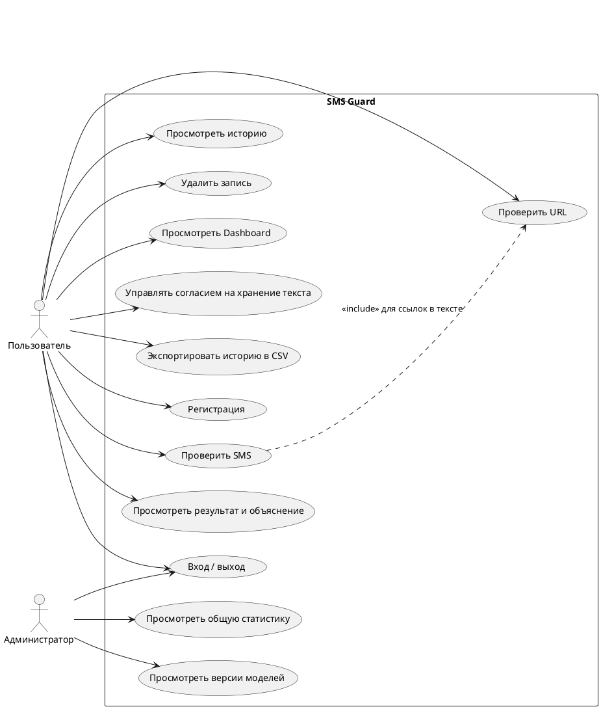

# Задание 1. Анализ предметной области и проектирование

> Это шаблон. Разделы заполнены черновиком; добавьте свои примеры, скриншоты и выводы,
> чтобы объём был 5–8 страниц.

## 1. Угрозы (не менее 6 категорий)

| № | Категория | Искусственный пример SMS | Признаки социальной инженерии |
|---|---|---|---|
| 1 | Поддельный банк | «Служба безопасности банка: подтвердите данные по ссылке http://secure-bank-verify.example/login» | авторитет, ссылка, запрос данных |
| 2 | «Блокировка карты» | «Ваша карта заблокирована! Срочно подтвердите данные: http://bank-kz-verify.test» | срочность, страх |
| 3 | Выигрыш / приз | «Поздравляем! Вы выиграли 1000$. Получите приз: bit.ly/prize-claimtest» | выгода, срочность |
| 4 | Служба доставки | «Ваша посылка ожидает оплаты таможенного сбора 350 ₸: http://post-delivery-pay.example» | срочность, мелкая сумма |
| 5 | «Родственник в беде» | «Мама, у меня проблемы, срочно переведи 50 000 на этот номер. Никому не говори.» | страх, секретность, срочность |
| 6 | Запрос кода из SMS | «Сотрудник банка: назовите код из SMS для отмены подозрительной операции.» | авторитет, страх |
| 7 | Поддельные госуслуги / штрафы | «Вам назначен штраф. Оплатите в течение 24 часов: http://gov-fine-pay.test/check» | авторитет, страх, срочность |
| 8 | Инвестиционное мошенничество | «Гарантированный доход 30% в день! Вступайте сегодня: http://prize-claim.example/win» | выгода, срочность |

Все примеры искусственные, ссылки на зарезервированных доменах.

## 2. Аналоги (не менее 3)

| Аналог | Назначение | Сильные стороны | Ограничения |
|---|---|---|---|
| Встроенный спам-фильтр смартфона | Фильтрация входящих SMS | Работает автоматически, без действий пользователя | Закрытые правила, нет объяснения причин |
| Google Safe Browsing | Проверка URL по базе опасных сайтов | Огромная база, постоянные обновления | Новые ссылки могут отсутствовать в базе; проверяет только URL, не текст |
| VirusTotal | Агрегатор антивирусов и репутации URL | Много движков, подробный отчёт | Нужен ручной ввод; нет анализа текста SMS и социальной инженерии |
| Антиспам оператора связи | Фильтрация на стороне сети | Массовое покрытие | Правила не покрывают новые шаблоны; нет объяснений |

## 3. Целевая аудитория и роли

- **Пользователь** — рядовой владелец телефона, проверяет SMS и ссылки.
- **Администратор** — видит агрегированную статистику по системе без текстов чужих SMS.

## 4. Диаграмма вариантов использования (PlantUML)

Вставьте код на plantuml.com или в расширение PlantUML для VS Code и сохраните картинку в `docs/figures/`.

## 5. Таблица требований (MoSCoW)

| Код | Требование | Приоритет |
|---|---|---|
| ФТ-1.1 | Регистрация (логин, e-mail, пароль) | Must |
| ФТ-1.3 | Авторизация, пауза после 5 неудачных попыток | Must |
| ФТ-1.4 | Пароли хранятся как хеш с солью | Must |
| ФТ-1.7 | Пользователь видит только свои проверки | Must |
| ФТ-1.9 | Администратор видит агрегаты без текстов | Should |
| ФТ-2.1 | Ввод SMS 1–1000 символов | Must |
| ФТ-2.2 | Определение языка (ru, kk, en, other) | Should |
| ФТ-2.5 | Словарь правил, ≥ 6 групп | Must |
| ФТ-2.6 | ML-вероятность P_sms | Must |
| ФТ-2.7 | Автоматическая проверка URL из текста (до 3) | Must |
| ФТ-3.2 | ≥ 20 числовых признаков URL | Must |
| ФТ-3.9 | ML-классификация URL (SAFE/SUSPICIOUS/DANGEROUS) | Must |
| ФТ-3.10 | Ссылки в результатах некликабельны | Must |
| ФТ-3.11 | Внешний сервис репутации | Could |
| ФТ-2.x | Risk Score 0–100, причины, рекомендация | Must |
| ФТ-2.6 (Dashboard) | Панель мониторинга | Should |
| ФТ-2.7 (История) | История с фильтрами и пагинацией | Must |
| ФТ-2.7 (CSV) | Экспорт истории в CSV | Could |
| НФТ-1 | Анализ SMS ≤ 500 мс | Should |
| НФТ-2 | Dashboard ≤ 2 с при 1000 записях | Should |
| НФТ-4 | Запросы к БД через ORM | Must |
| НФТ-5 | Экранирование вывода (XSS) | Must |
| НФТ-6 | Лимит 30 проверок в минуту | Should |
| НФТ-7 | Секреты в .env, DEBUG=False в демо | Must |
| НФТ-9 | Тексты SMS не пишутся в логи | Must |
| НФТ-10 | Адаптивная вёрстка 360/768/1366 | Should |
| НФТ-15 | Покрытие ml/ и risk/ ≥ 60% | Should |

Уточните приоритеты по своему усмотрению и добавьте остальные ФТ/НФТ из разделов 2–3 ТЗ.
